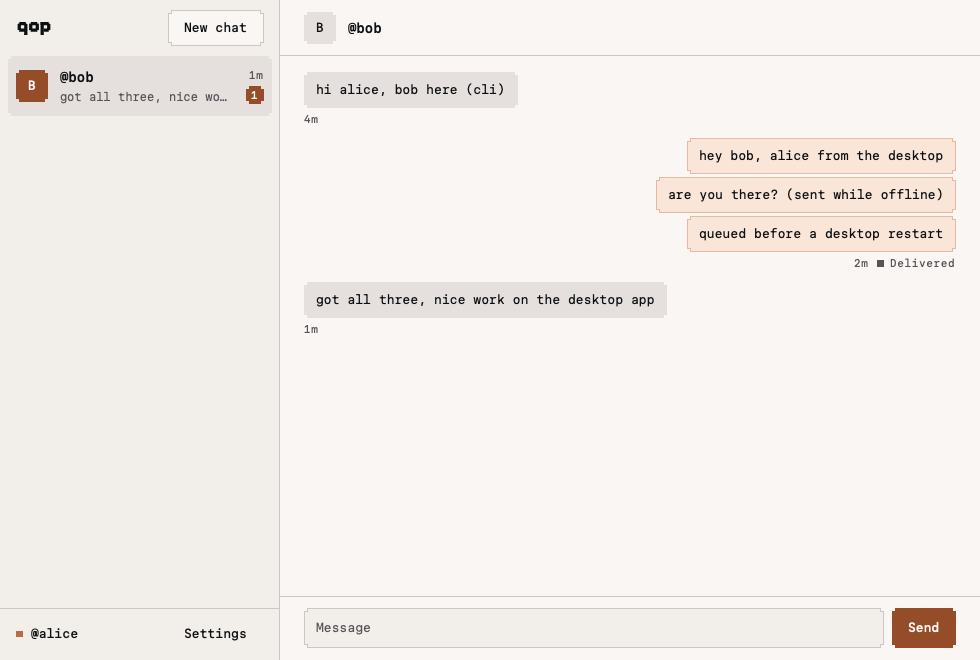

# Desktop chat E2E, 2026-11-08

Milestones 3 (receive) and 4 (send) of `docs/research/desktop-app-plan.md` on `feat/desktop-rune`. The stack, the scripted phone and the desktop linking steps are those of `desktop-linking-e2e.md`; the CLI side follows `cli-online-chat-e2e.md`, with a CLI device for @bob instead of a phone.

## Result

Passed on macOS 27 (Apple silicon), desktop @alice ↔ CLI @bob:

| Check | Result |
| --- | --- |
| CLI sends; desktop saves, ACKs, shows it unread | Passed |
| Desktop sends; CLI prints it; desktop shows Delivered (`sent`) only after the ACK | Passed |
| Desktop sends while Bob is offline: Queued with backoff; Bob starts; delivered | Passed, ~10 s after Bob came back |
| Queued message survives a desktop restart and is delivered after it | Passed, ~10 s after Bob came back |
| Messaging starts `Verifying` and turns `Ready` only on the desktop's own membership read | Passed |

- Transport: both sides used the public relay (`relay.minip2p.com`). The desktop dials contacts by peer ID only (no LAN discovery), so without a relay it reaches only peers that dialed it.
- Anvil runs with `--block-time 1`. Live authorization needs a registry head strictly newer than the last confirmation, and an Anvil that mines only on transactions keeps one head for minutes; with it, re-authorization after `MAX_AUTH_AGE_MS` would fail (correctly) until something is mined.
- Not exercised here: real sleep/wake (the clock-gap detector is unit-tested), revocation (milestone 6), and the GUI window itself: this session had no screen-recording permission (`screencapture`: "could not create image from display"). The GUI ran on the same data directory and showed the last message arrive (`QOP_PRINT_OFFER=1` output); the image below is the `live` scene, a headless Rune render of that data directory through the real UI code.



## Stack

As in `desktop-linking-e2e.md`, except:

```sh
anvil --port 18545 --block-time 1 --silent > /tmp/qop-e2e/anvil.log 2>&1 & echo $! > /tmp/qop-e2e/anvil.pid
# env.sh additionally exports the relay, for the desktop and the CLI:
export QOP_RELAY_ADDRS=/dns/relay.minip2p.com/udp/19876/quic-v1/p2p/12D3KooWNAHhp6rp11SvCDA84zua3hhEYTLNjgKmEDmt1BddtLdf
```

`desktop` is `desktop/target/debug/qop-desktop`, `phone` is `node --no-warnings cli/scripts/desktop-phone.ts` and `qop` is `node --no-warnings cli/src/main.ts`, all from the repo root with `/tmp/qop-e2e/env.sh` sourced.

Headless stdin commands once linked: `chat HANDLE` (New chat), `open HANDLE`, `send HANDLE TEXT…`, `retry ID-PREFIX`. Each model change prints the phase line plus one line per message (`<id8> received|sent:Queued|sent:Sent|sent:Failed "text"`).

## Cases

### Link both devices

```sh
cd /tmp/qop-e2e && mkfifo a.in && touch a.cmds && (tail -f a.cmds > a.in & echo $! > tail-a.pid); cd -
phone register alice
QOP_DATA_DIR=/tmp/qop-e2e/desktop desktop --headless --link alice < /tmp/qop-e2e/a.in > /tmp/qop-e2e/desktop.log 2>&1 & echo $! > /tmp/qop-e2e/desktop.pid
until grep -q 'qop-pair1\.' /tmp/qop-e2e/desktop.log; do sleep 1; done
phone approve "$(grep -o 'qop-pair1\.[A-Za-z0-9_-]*' /tmp/qop-e2e/desktop.log | tail -1)"
# phase=Linked handle=alice … relay=Connected messaging=Verifying …
# phase=Linked handle=alice … relay=Connected messaging=Ready …

export QOP_E2E_PHONE=/tmp/qop-e2e/phone-bob.json
phone register bob
QOP_DATA_DIR=/tmp/qop-e2e/cli-bob qop link --account bob > /tmp/qop-e2e/bob-link.log 2>&1 &
until grep -q 'qop-pair1\.' /tmp/qop-e2e/bob-link.log; do sleep 1; done
phone approve "$(grep -o 'qop-pair1\.[A-Za-z0-9_-]*' /tmp/qop-e2e/bob-link.log | tail -1)"
# Linked as @bob. Run qop start.
```

### CLI → desktop, desktop → CLI

```sh
QOP_DATA_DIR=/tmp/qop-e2e/cli-bob qop start --to alice --message "hi alice, bob here (cli)" > /tmp/qop-e2e/bob1.log 2>&1 & echo $! > /tmp/qop-e2e/bob.pid
# bob1.log: Queued for @alice. … / Sent to @alice.
# desktop:    chat @bob unread=1
#               93dc227b received "hi alice, bob here (cli)"
echo "open bob" >> /tmp/qop-e2e/a.cmds; echo "send bob hey bob, alice from the desktop" >> /tmp/qop-e2e/a.cmds
# bob1.log: @alice: hey bob, alice from the desktop
# desktop:    chat @bob unread=0
#               45b461a4 sent:Sent "hey bob, alice from the desktop"
```

### Offline queueing

```sh
kill "$(cat /tmp/qop-e2e/bob.pid)"
echo "send bob are you there? (sent while offline)" >> /tmp/qop-e2e/a.cmds
# desktop: 87fc614e sent:Queued "are you there? (sent while offline)"
sqlite3 /tmp/qop-e2e/desktop/qop.db "select substr(id,1,8), status, attempts, last_error from outbox"
# 87fc614e|queued|4|transport        (next attempt ~15 s out)
QOP_DATA_DIR=/tmp/qop-e2e/cli-bob qop start > /tmp/qop-e2e/bob2.log 2>&1 & echo $! > /tmp/qop-e2e/bob.pid
# ~10 s later, bob2.log: @alice: are you there? (sent while offline)
# desktop: 87fc614e sent:Sent "are you there? (sent while offline)"
```

### Restart with a queued message

```sh
kill "$(cat /tmp/qop-e2e/bob.pid)"
echo "send bob queued before a desktop restart" >> /tmp/qop-e2e/a.cmds
# desktop: 7aec78ed sent:Queued …
kill "$(cat /tmp/qop-e2e/desktop.pid)"; kill "$(cat /tmp/qop-e2e/tail-a.pid)"
# outbox: 7aec78ed|queued|2|transport
(tail -n 0 -f /tmp/qop-e2e/a.cmds > /tmp/qop-e2e/a.in & echo $! > /tmp/qop-e2e/tail-a.pid)
QOP_DATA_DIR=/tmp/qop-e2e/desktop desktop --headless < /tmp/qop-e2e/a.in > /tmp/qop-e2e/desktop2.log 2>&1 & echo $! > /tmp/qop-e2e/desktop.pid
# phase=Linked … messaging=Verifying …   7aec78ed sent:Queued "queued before a desktop restart"
QOP_DATA_DIR=/tmp/qop-e2e/cli-bob qop start > /tmp/qop-e2e/bob3.log 2>&1 & echo $! > /tmp/qop-e2e/bob.pid
# ~10 s later, bob3.log: @alice: queued before a desktop restart
# desktop: 7aec78ed sent:Sent "queued before a desktop restart"
```

### GUI and the render

```sh
kill "$(cat /tmp/qop-e2e/desktop.pid)"
QOP_DATA_DIR=/tmp/qop-e2e/desktop QOP_PRINT_OFFER=1 desktop > /tmp/qop-e2e/gui.log 2>&1 & echo $! > /tmp/qop-e2e/gui.pid
kill "$(cat /tmp/qop-e2e/bob.pid)" # bob3 holds the cli-bob lock
QOP_DATA_DIR=/tmp/qop-e2e/cli-bob qop start --to alice --message "got all three, nice work on the desktop app" > /tmp/qop-e2e/bob4.log 2>&1 & echo $! > /tmp/qop-e2e/bob.pid
# gui.log: 0b7d6be2 received "got all three, nice work on the desktop app"
kill "$(cat /tmp/qop-e2e/gui.pid)"
QOP_DATA_DIR=/tmp/qop-e2e/desktop desktop --snap live-chat-light.png --scene live --theme light --at 1.5 --scale 1
```

## Teardown

```sh
kill "$(cat /tmp/qop-e2e/bob.pid)" "$(cat /tmp/qop-e2e/tail-a.pid)" "$(cat /tmp/qop-e2e/api.pid)" "$(cat /tmp/qop-e2e/anvil.pid)"
pg_ctl -D /tmp/qop-e2e/pg stop
rm -rf /tmp/qop-e2e
```

## Automated coverage

`cd desktop && cargo test`: `engine/auth.rs` (connection binding, stale and same-head answers, a connection replaced and an invalidation mid-verification, recipient QID mismatch, sleep gating, self-membership verdicts), `engine/lifecycle.rs`, `store.rs` (the TS conflict rules), and in `engine/tests.rs` a linked desktop against a scripted contact on loopback: receive-save-ACK with resend and conflict, send-ACK-Delivered, queued while offline then delivered after a restart, and pauses on a peer rejection, a stuck head and an RPC outage that keep the key and messages.
