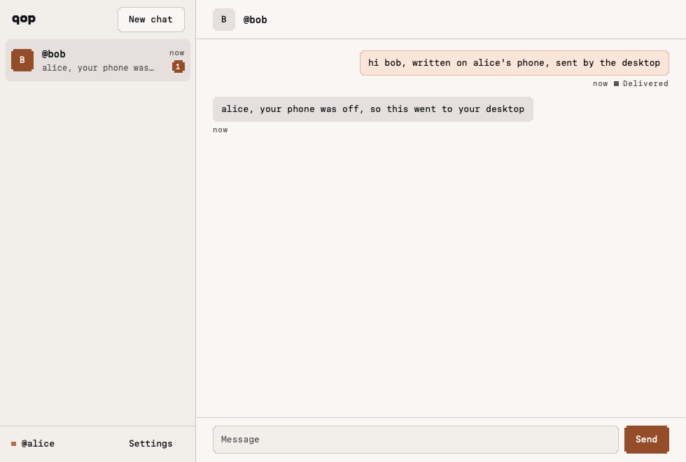
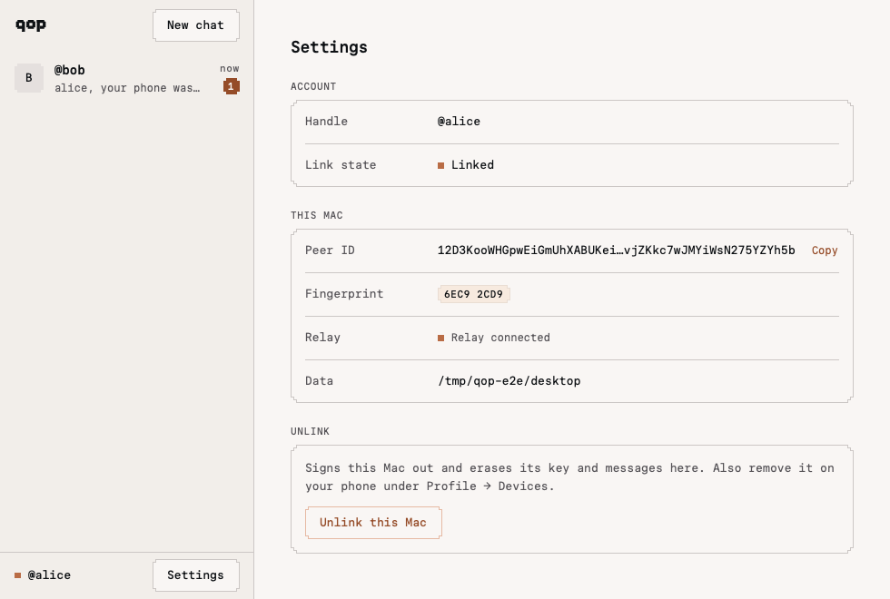

# Desktop sync and removal E2E, 2026-11-08

Milestones 5 (sync) and 6 (removal) of `docs/research/desktop-app-plan.md` on `feat/desktop-rune`. The stack and the linking steps are those of `desktop-linking-e2e.md` and `desktop-chat-e2e.md`: Anvil (`--block-time 1`), a throwaway Postgres, the API from source, the public relay, `qop-desktop --headless` as @alice, a CLI device as @bob, and the scripted phone (`cli/scripts/desktop-phone.ts`) as Alice's phone.

## Result

Passed on macOS 27 (Apple silicon):

| Check | Result |
| --- | --- |
| Phone hands off a message while Bob is offline: desktop answers `held` only once it is in its outbox (`queued`); phone's poll reports it still held | Passed |
| Bob comes online: desktop delivers it, marks it `sent` on Bob's ACK; the phone's poll returns the receipt | Passed, ~10 s after Bob started |
| Bob messages Alice while her phone is offline: the desktop receives it; the phone's catch-up over `/qop/sync/1` returns it (`#1`), and the next catch-up is empty | Passed |
| Phone removes the desktop on chain: the desktop stops its node, wipes its key and messages, shows `Revoked` | Passed, 53 s after the removal confirmed (the linked device's once-a-minute membership read) |
| `start-over` → handle entry → `link alice` pairs with a new key; the phone approves it; linked again, and sync works with the new device | Passed (new peer ID and fingerprint) |

- The phone is the script, not the app. Its new `handoff`, `poll` and `catchup` commands run the app's own sync client (`performHandoff`, `performPoll`, `performCatchup`, `outgoingHandoffRecord` from `mobile/src/lib/p2p-sync.ts`) with `createPeerSessions` from `@qop/protocol`, so it verifies the desktop as an active device of @alice before sending, as the app does. `remove` signs a remove-device intent with the owner key (`signRemoveDeviceIntentV1`) and submits it through the app's device-action client.
- The phone reached the desktop by peer ID through the relay (`QOP_RELAY_ADDRS`), which `handoff`/`poll`/`catchup` require.
- Not covered: the phone app itself, and rejection of a non-own peer end to end (`cargo test` covers it in-process, below).





## Stack

As in `desktop-chat-e2e.md` (Anvil with `--block-time 1`, `QOP_RELAY_ADDRS` in `/tmp/qop-e2e/env.sh`). `desktop` is `desktop/target/debug/qop-desktop`, `phone` is `node --no-warnings cli/scripts/desktop-phone.ts` and `qop` is `node --no-warnings cli/src/main.ts`, all from the repo root with `/tmp/qop-e2e/env.sh` sourced. The desktop reads stdin commands through a FIFO (`a.in`, fed by `tail -f a.cmds`).

## Cases

### Link @alice's desktop and @bob's CLI

```sh
phone register alice
# registered @alice qid=1 phone=0xa49d2660…
QOP_DATA_DIR=/tmp/qop-e2e/desktop desktop --headless --link alice < a.in > desktop.log 2>&1 & echo $! > desktop.pid
phone approve "$(grep -o 'qop-pair1\.[A-Za-z0-9_-]*' desktop.log | tail -1)"
# hello acknowledged by 6EC92CD9 (12D3KooWHGpwEiGmUhXABUKeidcGvjZKkc7wJMYiWsN275YZYh5b)
# api status=confirmed …
# desktop: phase=Linked handle=alice peer=12D3KooWHGpw… fingerprint=6EC92CD9 relay=Connected messaging=Ready

export QOP_E2E_PHONE=/tmp/qop-e2e/phone-bob.json   # only for bob's two commands
phone register bob
QOP_DATA_DIR=/tmp/qop-e2e/cli-bob qop link --account bob > bob-link.log 2>&1 &
phone approve "$(grep -o 'qop-pair1\.[A-Za-z0-9_-]*' bob-link.log | tail -1)"
# Linked as @bob. Run qop start.
unset QOP_E2E_PHONE
```

### (a) Handoff → held → delivery → receipt

```sh
phone handoff bob "hi bob, written on alice's phone, sent by the desktop"
# held 1f05fed7-31ae-495a-8206-11fbc104f66d by 12D3KooWHGpw…          (1.5 s, relay dial included)
# desktop:   chat @bob unread=0
#              1f05fed7 sent:Queued "hi bob, written on alice's phone, sent by the desktop"
sqlite3 desktop/qop.db "select substr(id,1,8), status, attempts, last_error from outbox"
# 1f05fed7|queued|1|transport          (Bob is offline)
phone poll
# 0 delivered, 1 still held

QOP_DATA_DIR=/tmp/qop-e2e/cli-bob qop start > bob1.log 2>&1 & echo $! > bob.pid
# ~10 s later, bob1.log: @alice: hi bob, written on alice's phone, sent by the desktop
# desktop:     1f05fed7 sent:Sent "hi bob, written on alice's phone, sent by the desktop"
phone poll
# receipt 1f05fed7-31ae-495a-8206-11fbc104f66d to=2 deliveredAt=2026-11-08T17:19:53.911Z
# 1 delivered, 0 still held
```

### (b) Catch-up of what arrived while the phone was offline

The phone script runs only for each command, so the phone is offline whenever Bob sends.

```sh
kill "$(cat bob.pid)"
QOP_DATA_DIR=/tmp/qop-e2e/cli-bob qop start --to alice --message "alice, your phone was off, so this went to your desktop" > bob2.log 2>&1 &
# bob2.log: Sent to @alice.
# desktop:     468dacf7 received "alice, your phone was off, so this went to your desktop"
phone catchup
# #1 @bob: alice, your phone was off, so this went to your desktop
# caught up to seq 1
phone catchup
# caught up to seq 1
```

The renders above were taken here (`desktop --snap … --scene live` and `--scene live-settings` with `QOP_DATA_DIR=/tmp/qop-e2e/desktop`, desktop stopped for the store lock), then the desktop was restarted on the same directory (`messaging=Verifying`, then `Ready`).

### (c) Removal, wipe, relink with a new key

```sh
phone remove
# removing 12D3KooWHGpwEiGmUhXABUKeidcGvjZKkc7wJMYiWsN275YZYh5b
# submitted 0xde5b9812… status=submitted
# api status=confirmed tx=0x83b64d81…                      (22:51:22)
# desktop, 22:52:10 at the latest: phase=Revoked handle=alice
ls desktop/
# lock  qop.db  qop.db-shm  qop.db-wal                     (device.key is gone)
sqlite3 desktop/qop.db "select (select count(*) from outbox), (select count(*) from inbox),
  (select count(*) from contacts), (select count(*) from identity), (select handle from revoked)"
# 0|0|0|0|alice

echo start-over >> a.cmds
# phase=EnterHandle lookup=Idle
echo "link alice" >> a.cmds
# phase=Pairing handle=alice relay=Connected offer=qop-pair1.…
phone approve "$(grep -o 'qop-pair1\.[A-Za-z0-9_-]*' desktop2.log | tail -1)"
# hello acknowledged by 87E56365 (12D3KooWJxr5btz1R6jV4ZDSgmoiPuJ4vL9sSG9bgtzB52XmJAgw)   new key
# api status=confirmed …
# phase=Linked handle=alice peer=12D3KooWJxr5… fingerprint=87E56365 relay=Connected messaging=Ready

phone catchup
# caught up to seq 0                                       (a new holder: its own cursor, empty inbox)
phone handoff bob "and again from the relinked desktop"
# held 78a506fa-… by 12D3KooWJxr5…   → bob2.log: @alice: and again from the relinked desktop
phone poll
# receipt 78a506fa-9457-460b-a451-00658ef21ac0 to=2 …
```

## Teardown

```sh
kill "$(cat bob.pid)" "$(cat desktop.pid)" "$(cat tail-a.pid)" "$(cat api.pid)" "$(cat anvil.pid)"
pg_ctl -D /tmp/qop-e2e/pg stop
rm -rf /tmp/qop-e2e
```

## Automated coverage

`cd desktop && cargo test`, in `src/engine/tests.rs` against Alice's scripted phone on loopback: handoff → `held` (saved `queued` first) → idempotent repeat, `conflict` for other content under the same id, `invalid` for a forged sender, a message to ourselves or another composer → delivery to Bob on his ACK → receipt on poll; catch-up pages of 64 rows from the inbox cursor, an empty page at the end, `lastSeq` for a cursor past it, and a message arriving between pages; streams reset without storing anything from an active device of another account, from a key that is nobody's device, and from our own phone while messaging is paused. `src/engine/sync.rs` checks that catch-up packing stays under the 64 KiB frame cap. Removal: an engine test revokes on the registry's removal marker (never on an RPC failure), wipes, and relinks with a fresh key after Start over.
